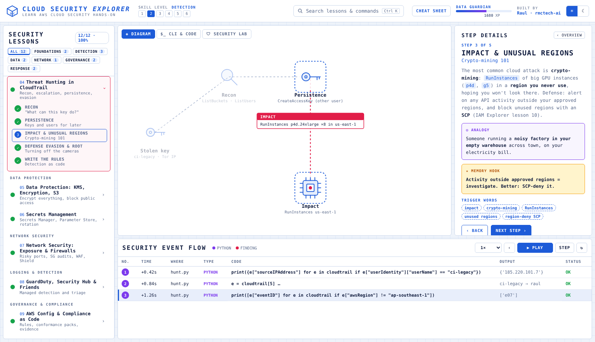

# 🛡️ Cloud Security Explorer — Learn AWS Cloud Security hands-on

An interactive, step-by-step course on **AWS Cloud Security** for Cloud Engineers heading toward Cloud Security and Security Architect roles: shared responsibility, root and credential hygiene, CloudTrail forensics and threat hunting, KMS and data protection, secrets management, network exposure, GuardDuty / Security Hub / Inspector / Macie, AWS Config compliance-as-code, incident response, automated remediation, and the Well-Architected Security Pillar. Every lesson animates how an attack or a control flows through AWS, with analogies, memory hooks, trigger words, quizzes, and a **Security Lab** where you write real Python against realistic security data.

> Created by **Raul** ([@rmctech-ai](https://github.com/rmctech-ai)) · Freelance AI Automation Specialist on the path to Cloud Security.
> Part of the Explorer series: [Linux Explorer](https://github.com/rmctech-ai/linux-explorer) · [Python Explorer](https://github.com/rmctech-ai/python-explorer) · [IAM Explorer](https://github.com/rmctech-ai/iam-explorer) · [VPC Explorer](https://github.com/rmctech-ai/vpc-explorer) · [IaC Explorer](https://github.com/rmctech-ai/iac-explorer) · [Serverless Explorer](https://github.com/rmctech-ai/serverless-explorer) · [CI/CD Explorer](https://github.com/rmctech-ai/cicd-explorer).
> 🏠 Part of **[Raul's Cloud Learning Hub](https://rmctech-ai.github.io/)** · Live course: https://rmctech-ai.github.io/CloudSecurity-Explorer/
> The Explorer course format is inspired by [Protocol Explorer](https://protocol-explorer-alpha.vercel.app/) by Dilum Sanjaya. All lessons, labs and study tools are my own work.



---

## ▶ Run it

No build step. Plain HTML/CSS/JS.

```bash
python3 -m http.server 8000     # then open http://localhost:8000
```

### Publish on GitHub Pages
```bash
git init && git add . && git commit -m "Cloud Security Explorer"
git branch -M main
git remote add origin https://github.com/rmctech-ai/cloudsecurity-explorer.git
git push -u origin main
```
GitHub → **Settings → Pages → Deploy from a branch → `main` / root → Save** → `https://rmctech-ai.github.io/cloudsecurity-explorer/`

---

## 🧭 How to use it

| Area | What it does |
|---|---|
| **Lessons** (left) | 12 lessons grouped by track. Click to expand steps. Dots show progress. |
| **Diagram** tab | Animated scene for every step. |
| **$_ CLI & CODE** tab | Types out real commands/code for the step with realistic output. |
| **🛡 SECURITY LAB** tab | **Security Lab**: real Python (Pyodide, running in your browser) preloaded with realistic security data: 14 CloudTrail events from a simulated key compromise, an IAM credential report, S3 bucket configurations, security groups, GuardDuty findings and an EventBridge event, plus a fake `boto3` that records every IAM / EC2 / S3 / Secrets Manager / SNS call your code makes (`calls()`). You'll write the same scripts security engineers write at work: credential audits, CloudTrail threat hunts, bucket and SG audits, finding triage, a Config custom rule, a leaked-key containment script, an auto-remediation Lambda and a weekly posture report. Each challenge is checked automatically. |
| **Step Details** (right) | Explanation, **Analogy**, **Memory Hook**, **Trigger Words**, real-world notes, warnings. |
| **Security Event Flow** (bottom) | Log of every command so far with type, output and status. |
| **XP & levels** | Earn XP for steps, lessons, quizzes and challenges. Saved in your browser. |
| **Cheat Sheet** | Master hooks + key syntax for every lesson (also [`CHEATSHEET.md`](CHEATSHEET.md)). |

**Keyboard:** `→` / `←` steps · `Space` play · `Ctrl+K` search · `Esc` close.

---

## 📚 Curriculum (12 lessons · 60 steps · 48 quiz questions · 12 hands-on challenges)

| # | Lesson | Track | You'll learn |
|---|---|---|---|
| 01 | Cloud Security Foundations ⚑ | FOUNDATIONS | Shared responsibility, CIA, defense in depth |
| 02 | Root & Account Hygiene ⚑ | FOUNDATIONS | Root lock-down, MFA, credential report, stale keys |
| 03 | CloudTrail: The Flight Recorder ⚑ | DETECTION | Who did what, when, from where |
| 04 | Threat Hunting in CloudTrail ⚑ | DETECTION | Recon, escalation, persistence, evasion |
| 05 | Data Protection: KMS, Encryption, S3 ⚑ | DATA | Encrypt everything, block public access |
| 06 | Secrets Management ⚑ | DATA | Secrets Manager, Parameter Store, rotation |
| 07 | Network Security: Exposure & Firewalls ⚑ | NETWORK | Risky ports, SG audits, WAF, Shield |
| 08 | GuardDuty, Security Hub & Friends ⚑ | DETECTION | Managed detection and triage |
| 09 | AWS Config & Compliance as Code ⚑ | GOVERNANCE | Rules, conformance packs, evidence |
| 10 | Incident Response: Leaked Access Key ⚑ | RESPONSE | Contain, investigate, eradicate, recover |
| 11 | Automated Remediation ⚑ | RESPONSE | EventBridge + Lambda fix it in seconds |
| 12 | Security Pillar, Guardrails & Career Map ⚑ | GOVERNANCE | Well-Architected, multi-account, capstone |

⚑ = has a hands-on challenge.

## 🎯 Study plan & capstone

- **Week 1:** Lessons 1–4 (foundations, account hygiene, CloudTrail, threat hunting). Solve every lab challenge.
- **Week 2:** Lessons 5–8 (data protection & KMS, secrets, network security, GuardDuty / Security Hub).
- **Week 3:** Lessons 9–12 (Config & compliance, incident response, auto-remediation, Security Pillar & capstone).

**Capstone:** In a free-tier AWS account, enable an organization (or multi-region) CloudTrail, GuardDuty and Security Hub with the Foundational Security Best Practices standard. Deploy the lesson 11 auto-remediation Lambda with SAM and an EventBridge rule, open port 5432 to 0.0.0.0/0 on a test security group, and watch it get revoked. Put all your lab scripts in a `cloud-security-toolkit` GitHub repo with a write-up of the simulated incident.

## License
MIT © 2026 Raul (rmctech-ai)
